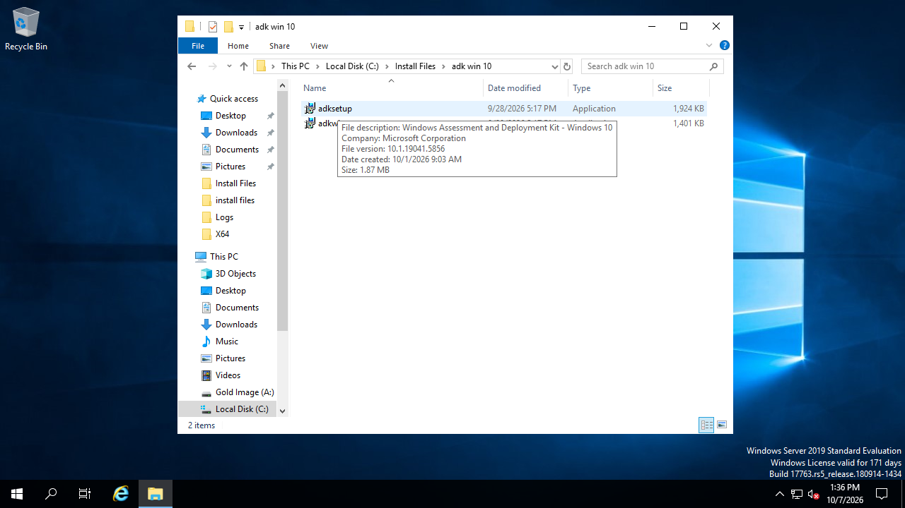
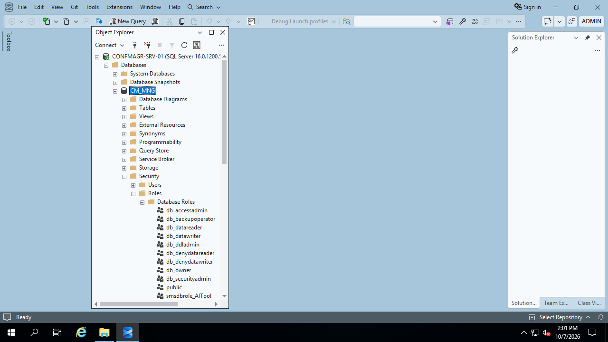
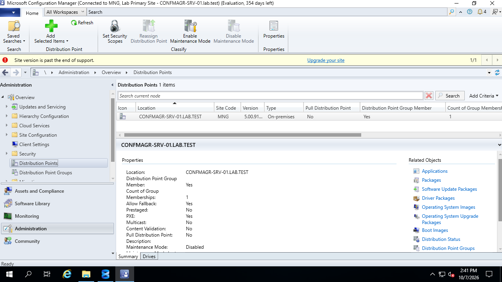
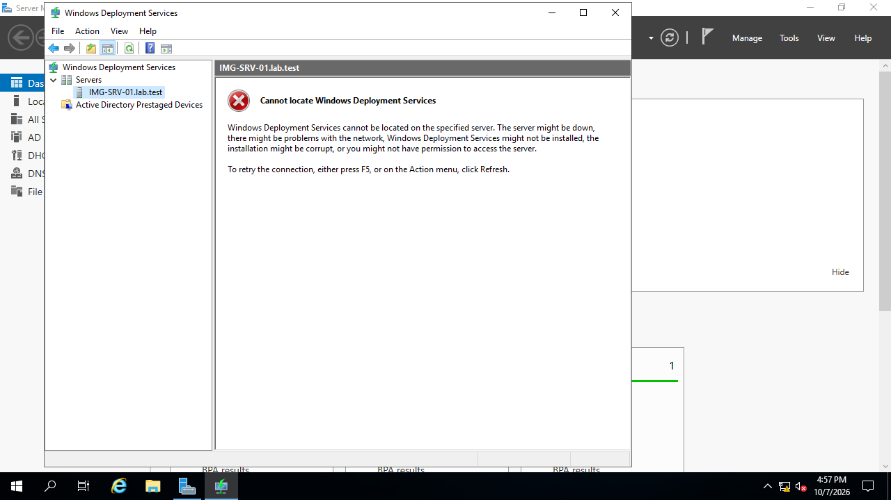
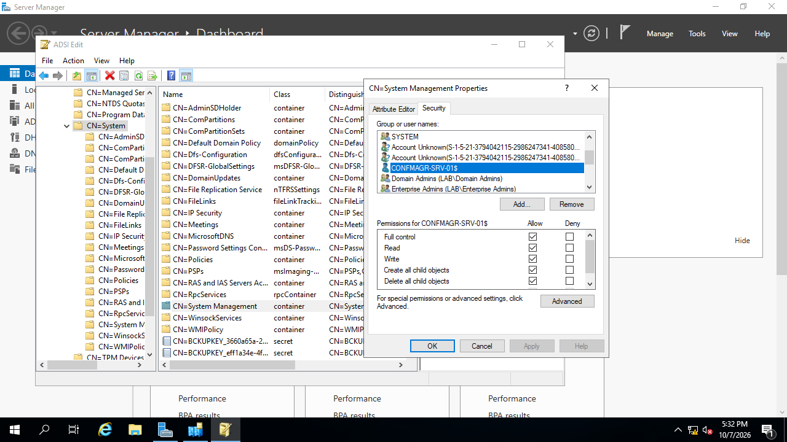
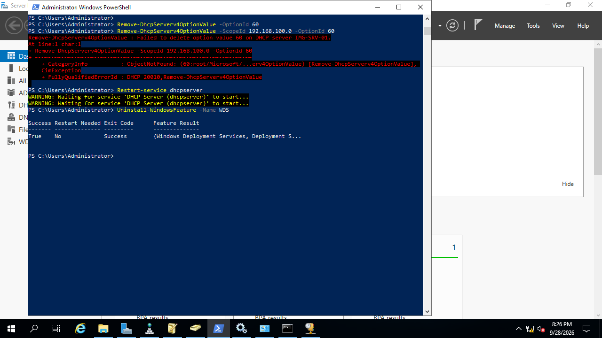
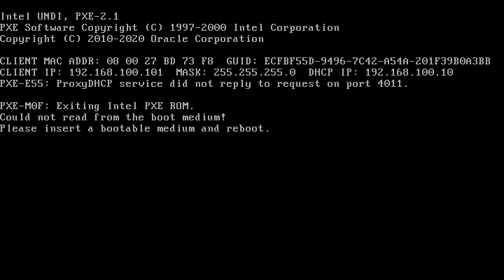
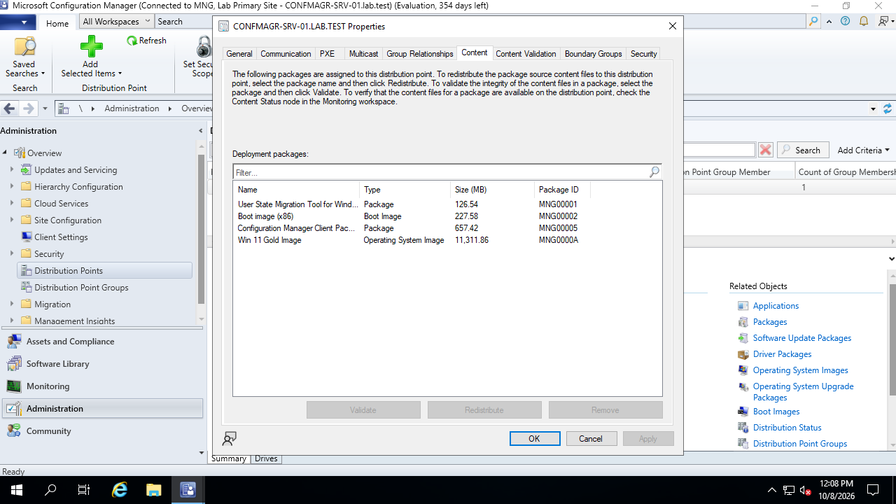
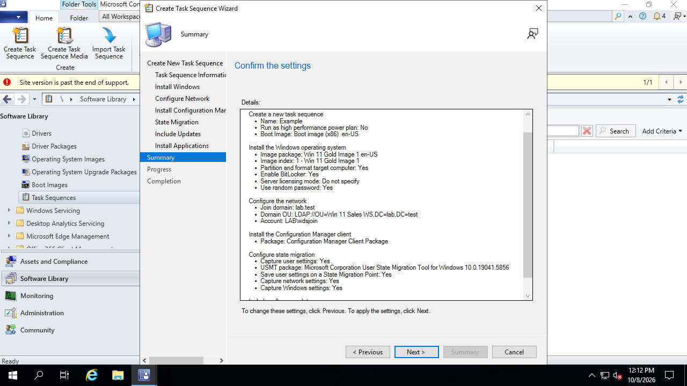

# Objective 4
Achieve zero-touch deployment of the gold image to department-specific workstations 
using Configuration Manager task sequences, with access rights enforced through Group
Policy.

## What was Configured
I stood up a second server, CONFMAGR-SRV-01, at static IP 192.168.100.11 on LABNET 
to take over OS distribution duties from IMG-SRV-01. Prerequisites were installed in
this order: Windows Assessment and Deployment Kit (ADK version 2004, retained for 
x86 boot image support), SQL Server 2022, then Configuration Manager (CM) Current Branch.
Established the standalone primary site MGR. See [Server Setup](#1-server-setup) for 
screenshot confirmation. 

On IMG-SRV-01, the WDS role was removed entirely and DHCP option 60 was cleared at 
both server and scope level so clients stopped receiving PXE responses from the 
decommissioned WDS. I also created the System Management container in Active Directory
Service Interfaces (ADSI), granting CONFMAGR-SRV-01 full control. See [WDS Cleanup and
System Management](#1-wds-cleanup-and-system-management) for screenshot confirmation.

A task sequence was then configured in Configuration Manager to deploy the gold 
image with the x86 boot image, and a fully touchless deployment was achieved on 
a Windows 11 client machine. See [Task Sequence Deployment](#1-task-sequence-deployment) 
for screenshot confirmation.

**Explanation:**

Windows ADK is a toolkit for building boot images; CM uses it to generate the WinPE 
boot image that clients download via PXE. CM generates default boot images from the 
ADK's components during site setup. Boot images persist even after ADK uninstallation, 
but without ADK, new boot images cannot be generated and current boot images cannot 
be serviced.

SQL Server is a database engine that hosts data for applications that choose not to 
host their own data. When an application such as CM runs, it queries the data table 
created upon its install (on my site, CM_MNG) to pull all relevant information such 
as task sequences. All of CM's data exists as rows in a SQL Server database, which 
is organized as a table with columns and rows. If SQL Server is uninstalled or the 
database is destroyed while a CM site exists, the site will cease to function 
and must be rebuilt.

CM is the administrative layer on top of both; it provides the console GUI that 
manages SQL data and orchestrates deployments. A deployment is a set of parameters 
(such as whether it is required) tied to a collection, bound to an actionable item 
such as a task sequence. A collection is a group of devices or users automatically assembled by a rule (such 
as 'everyone in the Sales AD group') so membership updates itself whenever the rule 
re-runs. Everything matching a rule becomes a part of a collection that then receives
deployments aimed at them (chosen at deployment creation). A task sequence provides a series of steps to take on a machine, such 
as how to partition the disk, apply the OS image, and join the domain. For a task 
sequence to run, every piece of content it references must first be distributed to 
a Distribution Point (DP) — distributing content copies the actual files (images, 
packages) to a DP so clients can physically download them. Unlike an unattend.xml 
file, task sequence configuration is stored only on the server, improving security 
by preventing access to unattend.xml files left on the client machine.

The System Management container in AD is where CM publishes site information, such as 
the site boundaries and the location of the Management Point (MP), so that clients can 
automatically discover their site by querying AD. When a client attempts to boot and 
join a domain via PXE, it must know where to obtain the tools it needs — several 
boot images may be distributed by a server, or multiple servers may be DPs. An 
existing client with the CM agent installed can query AD to discover its site; a 
fresh unknown machine, meanwhile, discovers the MP through the PXE responder and 
DHCP. Without System Management, clients would have a much harder time locating 
their site infrastructure, leading to degraded discovery.

### 1. Server Setup

> *I had two disk wipes across this project. On the first, I one never found the true
cause of the recurring errors; the second wipe was due to incorrect ADK version
installation. The proper boot wim was never created by CM because the newest version 
of ADK does not support x86, which is needed for my lab due to UEFI limitations in 
VirtualBox. Since CM only generates boot media at install time, uninstalling the new 
version and installing ADK 2004 did not resolve the issue.*

> *I installed SQL Server to establish the database, and during troubleshooting,
installed SQL Server Management Studio (SSMS) as a companion. Within SSMS, I can examine
all data in the CM_MGR database including lists of available images and admin users.*

> *Installed CM with great care at every step — as was made clear, every configuration 
misstep at this stage is very difficult or involved to troubleshoot. Its prerequisite 
checker flags a long list of requirements (features, packages, permissions); I worked 
through them all, installing what was needed via PowerShell and Server Manager such 
as .Net Framework 3.5.*

### 2. WDS Cleanup and System Management

> *Removed the WDS role from the old server entirely, so there was no possibility of 
clients confusing the two deployment paths. I did keep the underlying materials 
(such as the images) intact — in the real world, you don't burn one bridge before 
confirming the new one works.*

> *Created the System Management container in Active Directory and granted the site 
server's computer account full control, so it could publish site data and create 
Computer objects for domain joins automatically.*

> *Cleared DHCP Option 60 at both server and scope level. With Option 60 still set, 
PXE traffic was still being directed at IMG-SRV-01 even though WDS was dead — on first
attempt, the client received a pointer to a server that was no longer functioning.*

### 3. Task Sequence Deployment

> *I hadn't realized each individual piece of content had to be individually 
distributed to a DP before it could be used. I assumed it was automatic once selected 
for the task sequence. The client reported having nothing to boot from even after I 
had ensured that the x86 boot present and formed properly with ADK 2004; distributing
the content to the DP prior to deploying the task sequence was the solution.*

> *Creating the task sequence itself is straightforward- settings are selected such
as the boot and install images to use (this is what caused some confusion related to
the DP earlier), domain join information, and configuration state. The task sequence
may be further edited for OOBE configuration once the initial wizard sets up the base
sequence.*